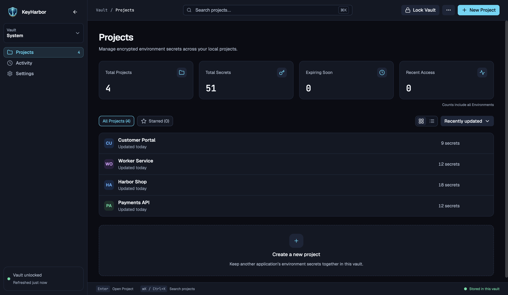
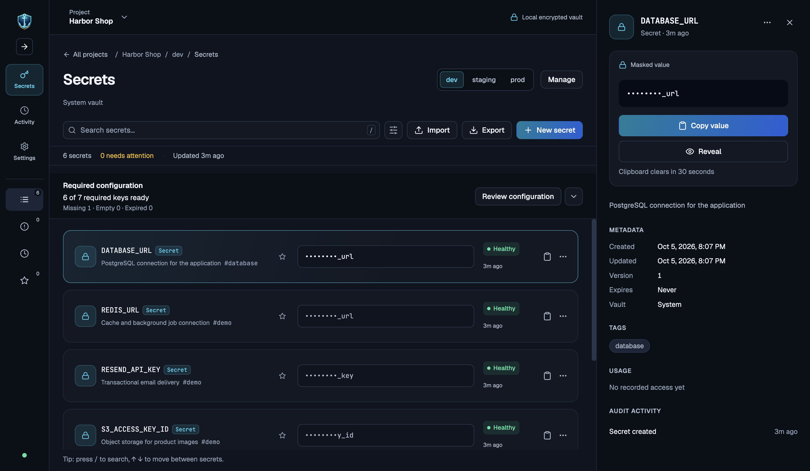
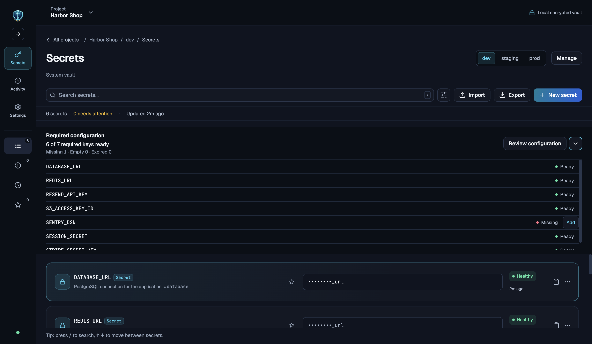
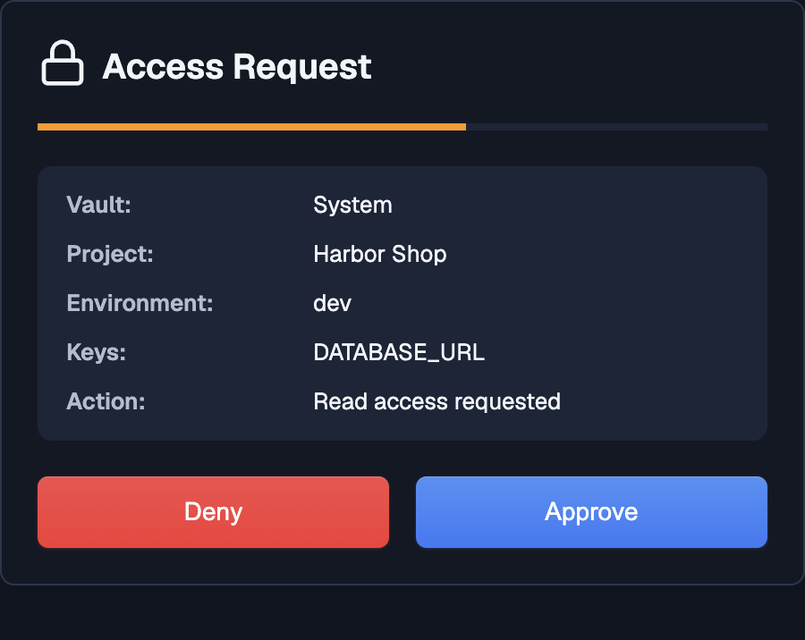
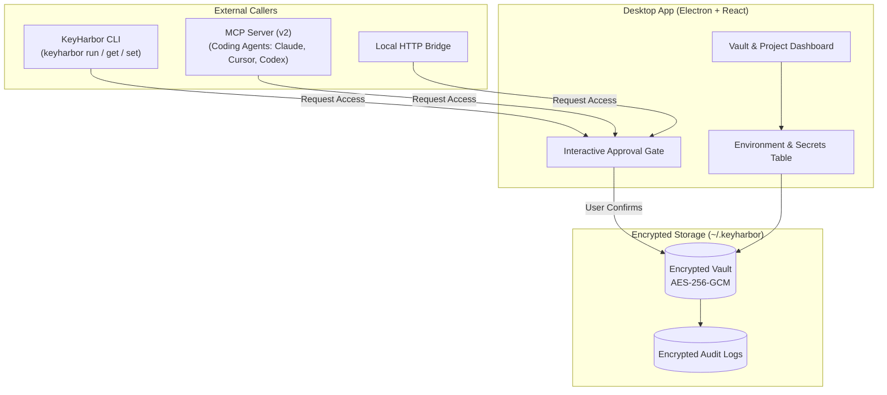

<div align="center">


# KeyHarbor

**A local-first, zero-knowledge secrets workspace and configuration manager for developers and AI coding agents.**

[](https://github.com/varunyn/KeyHarbor) [](https://github.com/varunyn/KeyHarbor) [](https://modelcontextprotocol.io) [](LICENSE)

</div>

---

KeyHarbor gives developers a safe, encrypted space to manage application credentials, validate `.env` requirements, and inject secrets into CLI commands or AI workflows. Every secret read or write through external tools requires deliberate, interactive approval—keeping credentials off the cloud, out of prompt logs, and protected from silent exfiltration.

**100% free to use. Works entirely offline with no accounts, subscriptions, or telemetry.**
---

## See KeyHarbor in action

Real screenshots of the desktop app on macOS, using a temporary demo vault with fictional projects and credentials. Secret values remain masked.

**Your projects, together in one local vault.**



**Separate environments, masked secrets, and useful metadata.**



<details>
<summary><strong>Configuration checks and explicit access approval</strong></summary>

Compare an environment against its required keys. This demo deliberately omits `SENTRY_DSN`, so the checklist marks it as missing.



External secret requests open a desktop prompt showing the vault, project, environment, and requested key. You choose whether to approve or deny access.



</details>

---

## Highlights

- 🔒 **Zero-Knowledge Local Encryption**: Vaults are encrypted at rest with AES-256-GCM using authenticated key derivation. Biometric unlock supported via Touch ID on macOS.
- 🛡️ **Interactive Approval Gates**: Any external caller—whether the CLI, the MCP server, or the local HTTP bridge—triggers a desktop approval prompt detailing the requesting process, target project, and environment. No background exfiltration.
- 🤖 **Model Context Protocol (MCP v2)**: Built-in stdio MCP server enabling AI coding assistants (Claude Code, Cursor, Codex, etc.) to safely list, inspect, and set project secrets under human review.
- 📁 **Project & Environment Isolation**: Organize credentials hierarchically (`Vault → Project → Environment → Secrets`). Maintain independent `dev`, `staging`, and `prod` configurations without accidental value bleed or fallback.
- ✅ **Configuration Baseline Checks**: Audit environments against `.env.example` templates. Instantly see whether required variables are **Ready**, **Missing**, **Empty**, or **Expired**.
- 🔄 **Safe Import & Export**: Parse `.env` files up to 1 MiB / 5,000 assignments with masked visual reviews and explicit conflict resolution. Export keys-only templates, secret references, or encrypted backups.
- 📜 **50-Version History & Point-in-Time Rollback**: View granular change history and revert any credential to previous versions with a single click.
- 🚫 **100% Offline & Private**: Core operations run on your machine. No accounts, no analytics, no cloud backends.

---

## Architecture & Workflow



---

## Quick Start

### Download installers

Get the latest installers from [GitHub Releases](https://github.com/varunyn/KeyHarbor/releases/latest). Expand **Assets** and choose the package for your operating system:

| Operating system | Package | Installation |
| --- | --- | --- |
| macOS (Apple Silicon) | `KeyHarbor-macOS-<version>-arm64.dmg` | Open the DMG and drag KeyHarbor into Applications. |
| macOS (Intel) | `KeyHarbor-macOS-<version>-x64.dmg` | Open the DMG and drag KeyHarbor into Applications. |
| Windows (x64) | `KeyHarbor-Windows-<version>.exe` | Run the installer. |
| Linux (x64) | `KeyHarbor-<version>.AppImage` | Make the file executable, then run it. |

The installers include their runtime; Node.js and npm are only needed when running from source. The macOS app is ad-hoc signed and is not Apple-notarized.

### Prerequisites for running from source

- **Node.js**: `20.19+` or `>= 22.12`
- **npm**: `10+`
- **Go**: `1.25+` to build the bundled credential proxy from source. Set `KEYHARBOR_GO_BINARY` if Go is not on your PATH. Installed desktop packages include the helper and do not require Go.
- **OS**: macOS 13+ (Apple Silicon & Intel), Windows 10+ (x64 / arm64), or Linux (64-bit)

### Running from Source

```bash
# Clone repository
git clone https://github.com/varunyn/KeyHarbor.git
cd KeyHarbor

# Install dependencies
npm install

# Start the application
npm start
```

### Packaging Binaries

To produce standalone installers:

```bash
# macOS (.dmg)
npm run build:mac

# Windows (.exe / NSIS)
npm run build:win

# Linux (.AppImage)
npm run build:linux
```

---

## CLI Reference

The KeyHarbor CLI allows you to read, write, and inject credentials into terminal commands. The desktop app must be running and unlocked; commands will trigger an interactive approval dialog before executing.

```bash
# List all accessible projects
keyharbor list

# Retrieve a specific secret (returns JSON with value and expiration)
keyharbor get myapp DATABASE_URL --env=prod

# Set or update a secret (requires write approval)
keyharbor set myapp STRIPE_KEY "sk_live_123456789" --env=prod

# Run a process with secrets injected directly into its environment
keyharbor run --project=myapp --env=dev -- npm run dev

# Omitting --env defaults to the project's designated default environment
keyharbor run --project=myapp -- docker compose up
```

---

## AI Assistant & MCP Integration

KeyHarbor ships with a Model Context Protocol (MCP v2) server over stdio. AI coding agents can inspect configuration requirements and read or set secrets under strict user approval.

### Use credentials without returning their values

Start the MCP server with `keyharbor mcp --secretless` to expose metadata and credential-use tools without the raw-secret read/write tools. The existing MCP mode remains available for workflows that deliberately need secret values.

The `authenticated_request` tool takes a project, secret key name, HTTPS origin, method, and path. KeyHarbor asks you to approve the temporary connection, then asks you to approve the individual request. Its local helper adds the credential internally and returns a bounded text/JSON response with credential filtering.

Each approval allows two minutes. Configure your MCP client's tool-call timeout to at least five minutes so it can wait for both prompts and the response. With the MCP v2 JavaScript SDK, pass `{ timeout: 300_000 }` as the second argument to `client.callTool(params, options)`. The server cannot override a client-side timeout.

Pending approvals send a desktop notification; clicking it opens the review prompt. On macOS, the Dock also requests attention. Allow KeyHarbor notifications in **System Settings → Notifications** if banners are disabled; Focus settings can also suppress them. Notifications contain no project, key, destination, or request details. Dismissing a notification does not approve or deny the request; the desktop prompt remains the approval gate.

Closing the main window asks whether to **Keep Running**, **Quit KeyHarbor**, or **Cancel**. You can remember your choice and change it under **Settings → When closing the window**. Background mode leaves KeyHarbor in the macOS menu bar or system tray; your current vault state and auto-lock policy still apply. The menu shows vault status and pending approvals, and provides Show, Review approvals, Settings, Lock Vault, and Quit. Quit (including Cmd+Q on macOS) locks the vault and revokes agent sessions through normal shutdown. If the tray icon is unavailable, the app offers Quit or Cancel instead of hiding the window.

For example, a tool call can request:

```json
{
  "projectName": "myapp",
  "environmentName": "dev",
  "key": "GITHUB_TOKEN",
  "origin": "https://api.github.com",
  "method": "GET",
  "path": "/repos/owner/repository/issues?state=open"
}
```

To launch a proxy-aware CLI or SDK with a placeholder in place of its key:

```bash
keyharbor agent --project=myapp --env=dev --key=GITHUB_TOKEN \
  --origin=https://api.github.com -- node my-agent.mjs
```

The child receives proxy settings, an ephemeral public CA certificate, and a placeholder for the selected key. Each matching HTTPS request requires desktop approval. Closing the command revokes its session; locking the vault revokes all sessions. The proxy token is a temporary capability, so keep it private. The helper holds the real credential briefly in memory and never persists a second secret collection.

For a local development checkout, use `node backend-build/cli/keyharbor.js` in place of the installed `keyharbor` command. MCP clients can run `node backend-build/cli/keyharbor-mcp.mjs --secretless` directly. Agent sessions can also be created and revoked with `create_agent_session` and `close_agent_session`.

This initial scope supports HTTPS over HTTP/1.1, configurable authentication headers, request bodies up to 256 KiB, and text/JSON responses up to 1 MiB. Redirects, compressed/binary responses, WebSockets, SSH, and database protocols are not supported. Clients must honor the proxy settings; Node's environment-proxy support depends on the child Node version. Use `authenticated_request` when a client does not support proxy configuration.

Private-network access and additional upstream CA certificates require explicit connection approval. Proxy configuration does not sandbox an agent: a process with unrestricted access to your user account can still access unrelated environment variables, files, and general CLI/MCP interfaces. Use a sandbox or separate identity for stronger isolation. Existing `keyharbor run` continues to inject real secret values into child environments; use `agent` for the placeholder/proxy workflow.

For a service on your LAN, macOS may also require **System Settings → Privacy & Security → Local Network → KeyHarbor**. This OS permission is separate from KeyHarbor's per-connection private-network approval. The app declares its local-network usage so macOS can explain the request; it does not enable the permission automatically. Proxy-generated upstream failures include a safe code in the response body and `X-KeyHarbor-Proxy-Error` header, such as `network_permission_denied`, `network_unreachable`, `network_policy_denied`, `tls_untrusted_certificate`, `dns_failure`, or `connection_refused`. Raw transport error text is never returned. A successful unauthenticated request from Terminal does not prove that the desktop app has macOS LAN permission.

The helper selectively adapts MIT-licensed Infisical Agent Vault code. Its pinned source provenance and redistribution notice are in [native/agent-proxy](native/agent-proxy).

### 1. Enable CLI / MCP in Settings

In the KeyHarbor desktop app, open **Settings** and ensure the CLI helper is installed, or build the backend locally with `npm run build:backend`.

### 2. Configure Your AI Client

#### Codex (`~/.codex/config.toml`)

```toml
[mcp_servers.keyharbor]
command = "keyharbor"
args = ["mcp"]
default_tools_approval_mode = "writes"
tool_timeout_sec = 60
```

#### Claude Desktop (`claude_desktop_config.json`)

```json
{
  "mcpServers": {
    "keyharbor": {
      "command": "keyharbor",
      "args": ["mcp"]
    }
  }
}
```

#### Cursor (`Settings → Features → MCP`)

- **Name**: `keyharbor`
- **Type**: `command`
- **Command**: `keyharbor mcp`

### Exposed Tools

- `keyharbor_status`: Check daemon status and vault unlock state.
- `list_projects`: Discover available projects and environments.
- `create_project`: Create a new project workspace.
- `list_secret_keys`: Enumerate key names in a project environment (metadata-only, requires read approval).
- `get_secret` / `get_secrets`: Fetch one or more secret values (prompts desktop approval).
- `set_secrets`: Store or update one or multiple secrets in batch (prompts desktop approval).

---

## Key Concepts

### Projects & Environments

- **Hierarchy**: Vaults contain **Projects**, which contain **Environments** (`default`, `dev`, `staging`, `prod`, etc.), which hold **Secrets**.
- **Isolation**: Each environment is strictly isolated. A missing variable in `prod` will never silently fall back to `dev`.
- **Default Resolution**: Every project specifies a persistent default environment. External requests (CLI, MCP, HTTP) that omit the `--env` flag target this default rather than whichever environment is active in the desktop GUI.

### Configuration Checklist & Auditing

- Define expected keys for any environment by pasting a `.env.example` file or uploading a template.
- The checklist classifies each requirement into one of four states:
  - 🟢 **Ready**: Key exists, holds a non-empty value, and has not expired.
  - 🟡 **Empty**: Key is defined but contains an empty string.
  - 🔴 **Missing**: Key is absent from the selected environment.
  - ⏰ **Expired**: Key has exceeded its recorded expiration date.

### Safe `.env` Import & Export

- **Parser Engine**: Safely processes UTF-8 files up to 1 MiB and 5,000 assignments. Supports quotes, multiline values, comments, and `export` prefixes.
- **Review Screen**: Values remain masked by default. Highlights diffs, duplicate occurrences, and novel keys with Add/Keep/Skip controls before committing to disk.
- **Export Formats**:
  1. `.env.example` (keys-only baseline)
  2. Safe reference links (`keyharbor://project/KEY?environment=dev`)
  3. Encrypted project backups (`.lkvb`)
  4. Raw text export (requires master password verification and emits an audit event)

---

## Security & Storage Model

- **Vault Encryption**: Encrypted using AES-256-GCM. Salt and key derivation parameters are stored alongside the vault.
- **Data Location**: Stored locally in `~/.keyharbor`. Installations migrated from previous versions will seamlessly read existing data from `~/.localkeys` without moving files or invalidating backups.
- **Access Logs**: Encrypted internal log tracking read, write, unlock, and lock operations with timestamps and caller identification.
- **Memory Hygiene**: Secrets displayed in the desktop app auto-mask after 30 seconds or when the window loses focus.

---

## Development & Testing

### Project Structure

```text
├── cli/                 # Stdio CLI and MCP v2 server implementations
├── src/
│   ├── main.ts          # Electron main process entry point
│   ├── preload.ts       # Typed contextBridge IPC interface
│   ├── modules/         # Vault crypto, storage, HTTP server, and logger
│   ├── dashboard/       # React views for Vault and Project management
│   ├── project/         # React views for Secrets table, imports, & checks
│   ├── renderer/        # Shared React components, Radix UI, & i18n
│   └── styles/          # Tailwind CSS and theme tokens
├── test/                # Unit and integration test suites
```

### Commands

| Command | Description |
| --- | --- |
| `npm start` | Builds renderer & backend, then launches Electron |
| `npm run test` | Executes unit tests via Node test runner |
| `npm run check` | Runs Ultracite read-only code quality & style checks |
| `npm run check:backend` | Validates TypeScript types and backend linting |
| `npm run fix -- <path>` | Formats a specific file using Oxfmt |
| `npm run build:backend` | Compiles backend TypeScript to `backend-build/` |
| `npm run build:renderer` | Compiles React views and assets via Vite |

## License

This project is licensed under the [MIT License](LICENSE).

### Native macOS window materials

On macOS, KeyHarbor uses the system interface font, a draggable unified title bar, standard window controls, and translucent navigation. macOS 26 and later use Apple's public Liquid Glass API when available; older systems use native sidebar vibrancy. Reduce Transparency or Increase Contrast uses solid surfaces. Secret tables, inspectors, and dialogs remain opaque.

Mac builds require Xcode command-line tools. `npm run build:desktop` builds the local Node-API window bridge; `npm run build:mac` builds it for both Apple Silicon and Intel. A macOS 26 or later SDK enables Liquid Glass; earlier SDKs compile the native-vibrancy fallback. The bridge uses public AppKit APIs and carries no third-party runtime dependency.
